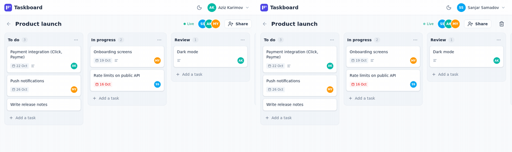
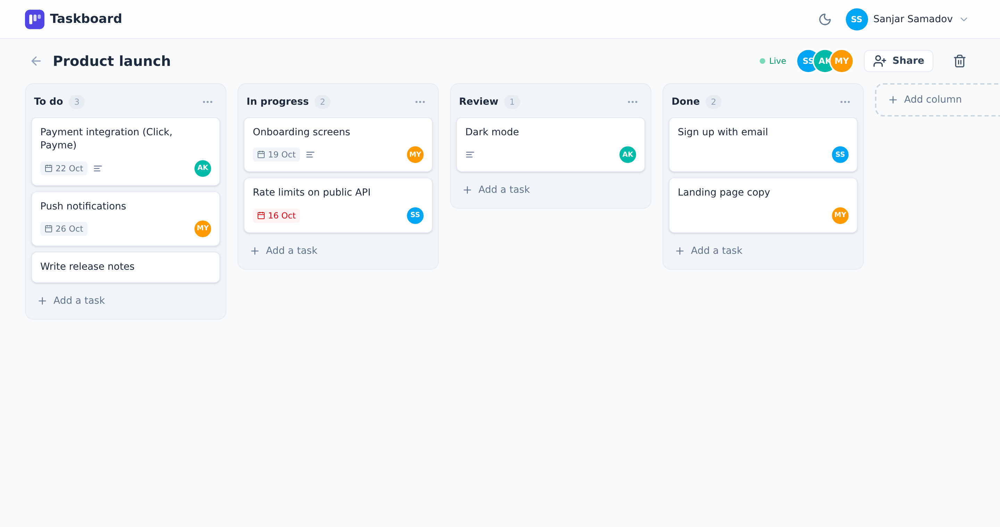
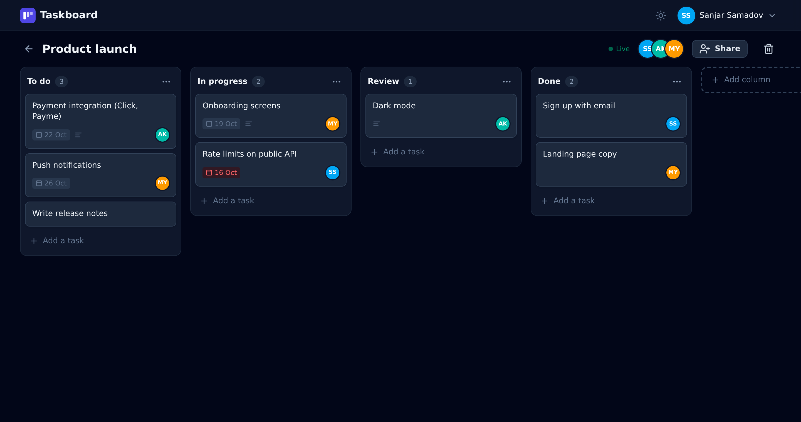
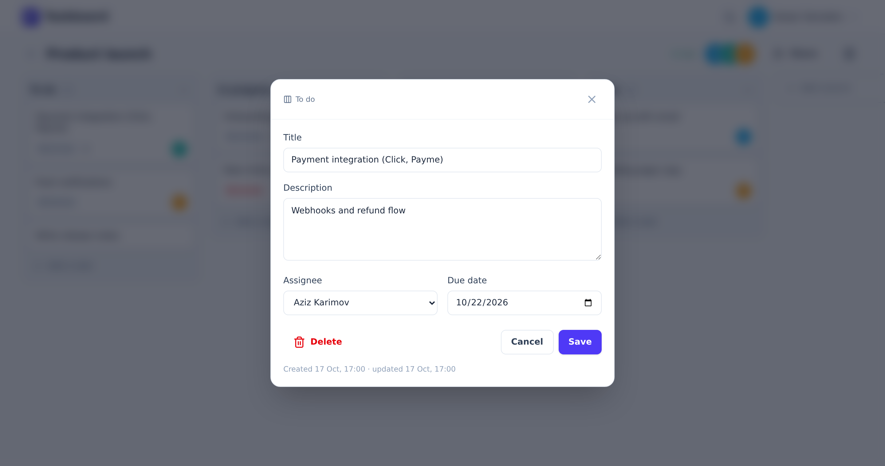

# taskboard

[](https://github.com/sanjar2709/taskboard/actions/workflows/ci.yml)

A kanban board for small teams. Create a board, invite people by email, drag tasks between columns,
and everyone on the board sees the changes right away, without refreshing the page.

Backend is FastAPI with PostgreSQL, frontend is Nuxt 4. I made it to have one full-stack project
where both sides are done properly, and to try real-time updates that keep working with several backend workers.



*Left and right are two different users. Aziz moves a task and adds a new one, Sanjar's screen updates by itself.*

## Features

- Boards with members: the owner invites people by email and can remove them
- Columns and tasks you can drag around, rename, add and delete
- Task details: description, assignee (any board member), due date, overdue dates in red
- Live updates over WebSocket with a "Live" indicator, automatic reconnect
- Dark mode, works on a phone (columns scroll sideways)
- JWT auth with refresh tokens, rate limit on login

## How it works

**Ordering.** Every column and task has a `position` number. When something is dropped between two
neighbours, it gets the value in the middle of theirs, so a move is a single `UPDATE` of one row,
not a renumbering of the whole list. After many drops into the same spot the gap becomes tiny,
then that one list is renumbered once (`backend/apps/common/ordering.py`).

**Live updates.** After any change the API publishes an event like `task.moved` to the Redis channel
`board:<id>`. Each backend process listens to those channels and forwards the event to the browsers
connected to it. So it doesn't matter which worker a user's WebSocket landed on, everyone gets the event
(`backend/core/realtime.py`).

On the frontend the events go into the Pinia store. Applying an event is idempotent: our own changes
come back over the socket too, and applying them a second time changes nothing. When the socket
connects (or reconnects) the board is loaded once more, because anything that happened while
there was no connection never arrives as an event.

**Permissions.** A board you're not a member of answers `404`, the same as a board that doesn't
exist. Renaming or deleting a board and managing members is for the owner only.

## Running it

```bash
cp .env.example .env    # set SECRET_KEY and database credentials
docker compose up -d
```

Open http://localhost:3000 and sign up. API docs are at http://localhost:8002/api/docs.

For development, run the database and Redis in Docker and the apps locally:

```bash
docker compose up -d db redis

cd backend
python -m venv venv && source venv/bin/activate
pip install -r requirements/dev.txt
alembic upgrade head
uvicorn main:app --reload --port 8002

cd ../frontend
npm install
npm run dev
```

## Tests

```bash
cd backend && pytest --cov
```

44 tests, 97% coverage, including WebSocket tests and one that starts two broadcasters against a real Redis
to check that an event published on one process reaches a socket on another (it runs when `TEST_REDIS_URL` is set,
CI sets it). The frontend is checked with ESLint, Prettier, `nuxt typecheck` and a production build in CI.

## Project layout

```
backend/
  apps/
    users/      auth
    boards/     boards, members, columns, WebSocket endpoint
    tasks/      tasks and moving them
    common/     ordering helpers, base model, test factories
  core/         settings, database, security, Redis broadcaster
  migrations/   Alembic
frontend/app/
  pages/        login, sign up, boards list, board
  components/   UI (buttons, inputs, modal), Board (column, task card, modals), Layout
  stores/       auth and board (Pinia)
  composables/  useApi (adds the token, refreshes it on 401), useBoardSocket
```

## Screenshots





## License

MIT
